# Cloud-Native Microservices Banking Platform on AWS

## Overview

This project describes a cloud-native microservices banking platform hosted on Amazon EKS and managed through GitOps with Argo CD.

**Architecture targets**
- 32 containerized workloads
- Go-based backend microservices
- gRPC synchronous service-to-service communication
- Kafka asynchronous event messaging
- PostgreSQL for persistent relational data
- Redis for caching, sessions, OTPs, and rate-limit data
- Terraform for AWS infrastructure provisioning
- GitHub Actions for continuous integration
- Argo CD and Helm for continuous delivery
- Prometheus, Grafana, Loki, Tempo, and OpenTelemetry for observability
- Velero and Amazon S3 for backup and recovery

> This document transcribes the supplied architecture diagram into Markdown. Values and design choices should be validated before implementation.

## High-Level Architecture

```mermaid
flowchart TB
    U[Web / Mobile Clients] --> D[GoDaddy: Registered Domain]
    D --> R53[Amazon Route 53 Public Hosted Zone]
    R53 --> A[Route 53 Alias Record]
    A --> NLB[AWS Network Load Balancer]
    NLB --> T[Traefik Ingress Controller]
    T --> GW[API Gateway: gRPC, Routing, AuthN/AuthZ, Rate Limiting]
    GW --> MS[30 Backend Microservices: Go]
    MS <--> PG[(PostgreSQL)]
    MS <--> REDIS[(Redis)]
    MS <--> KAFKA[(Kafka)]
    MS --> OTEL[OpenTelemetry]
    OTEL --> PROM[Prometheus]
    OTEL --> LOKI[Loki]
    OTEL --> TEMPO[Tempo]
    PROM --> GRAF[Grafana]
    PROM --> AM[Alertmanager]
    MS --> V[Velero Backup]
    PG --> V
    KAFKA --> V
    V --> S3[(Amazon S3 Backup Bucket)]
    CI[GitHub Actions CI] --> GH[GitHub Source Repository]
    CI --> DH[Docker Hub Image Registry]
    CI --> GR[GitOps Repository: Helm Values / Manifests]
    GR --> ARGO[Argo CD in EKS]
    ARGO --> EKS[Deploys Helm Releases to EKS]
```

## AWS Network Layout

- VPC CIDR shown in the diagram: `10.0.0.0/16`
- Three Availability Zones: `AZ-a`, `AZ-b`, and `AZ-c`
- Public subnets host or provide routes for public entry components.
- Internet Gateway provides internet routing for public subnets.
- The diagram shows three NAT Gateways.
- Private subnets contain Amazon EKS worker nodes.
- EKS managed node groups run the containerized workloads.
- Use route tables, security groups, and network policies with least-privilege rules.
- Keep worker nodes and stateful services private unless an explicit reviewed requirement says otherwise.

## Ingress and DNS

1. Users access the registered domain `vijaygudhithuri.in`.
2. The domain is registered with GoDaddy.
3. Nameserver delegation points DNS hosting to Amazon Route 53.
4. Route 53 public hosted zone contains an alias record.
5. The alias points to the AWS Network Load Balancer.
6. Traefik receives inbound traffic and routes requests to internal services.
7. The diagram shows TLS termination on port `443` and HTTP-to-HTTPS redirect on port `80`.
8. cert-manager and Let's Encrypt are shown for certificate issuance and renewal.

**Before implementation:** verify domain ownership, nameserver delegation, NLB target type, certificate validation method, and where TLS terminates. Avoid changing public DNS without explicit approval.

## Application Layer

The diagram shows an API Gateway and 30 named/representative Go backend microservices, with additional services to reach 32 containerized workloads overall.

### API Gateway responsibilities
- gRPC/API routing
- Authentication and authorization
- Rate limiting

### Representative services
- `auth`
- `authz`
- `customer`
- `account`
- `transaction`
- `ledger`
- `payment`
- `wallet`
- `card`
- `loan`
- `emi`
- `fixed-deposit`
- `recurring-deposit`
- `kyc`
- `fraud`
- `beneficiary`
- `notification`
- `statement`
- `report`
- Additional services to be confirmed in the service inventory

## Data and Messaging

### PostgreSQL
- Stateful workload in the diagram.
- Single database with a table prefix per service is indicated.
- Double-entry ledger and idempotency keys are called out.
- Persistent storage shown through EBS volumes and the EBS CSI driver.
- Validate whether a single database is appropriate for the required isolation, availability, backup, and recovery objectives.

### Redis
- Stateful workload in the diagram.
- Caching, sessions, OTPs, and rate-limit data.
- Persistent storage is shown through EBS volumes and the EBS CSI driver.
- Confirm persistence and failover requirements; not all Redis data needs durable storage.

### Kafka
- Stateful workload used for asynchronous domain events, including transfer, ledger, and notification events.
- Design should document broker topology, persistence, replication, partitioning, retention, and recovery.
- The diagram mentions an outbox pattern; implement transaction/event publishing carefully to avoid inconsistent database and event state.

## Identity and Access

- IAM roles for service accounts (IRSA) are shown for AWS access from Kubernetes workloads.
- An IAM OIDC provider is shown for the EKS cluster.
- Prefer least-privilege workload roles and avoid static AWS access keys in pods.
- HashiCorp Vault is the intended centralized secrets-management platform for this project.
- AWS-managed encryption or AWS KMS may still be needed for AWS service encryption, even when Vault manages application secrets.

## CI Pipeline

The diagram shows GitHub Actions as the CI system:

1. Developer pushes code to GitHub.
2. Matrix build compiles/tests Go services in parallel.
3. Trivy scans container images for vulnerabilities.
4. Images are published to a container registry.
5. Deployment manifests or Helm values are updated with image tags.
6. Changes are committed to the GitOps repository.

**Project decision:** use Docker Hub for application images, not Amazon ECR. The image in the source diagram labels ECR; that label must be treated as superseded by the project decision. Store Docker Hub credentials securely and use immutable image tags or digests.

## GitOps Delivery

- GitOps repository contains app-of-apps configuration and Helm charts/values.
- Argo CD runs inside EKS and watches the GitOps repository.
- Argo CD detects changes, renders Helm, and synchronizes desired state into EKS.
- The diagram shows application groups for banking, storage, ingress, TLS/cert-manager, monitoring, logging, tracing, autoscaling, backup, Argo CD, and alerting.
- Jenkins/GitHub Actions should not independently run `helm upgrade` for applications that Argo CD manages.

## Observability

The diagram includes:
- **Grafana:** dashboards for RPS, error rate, latency percentiles, CPU, memory, and logs
- **Prometheus:** metrics collection and storage
- **Alertmanager:** alert routing to Slack, email, or PagerDuty
- **Loki:** log aggregation
- **Promtail:** log shipping (validate current support/lifecycle and alternatives before implementation)
- **Tempo:** distributed tracing
- **OpenTelemetry Collector:** traces, metrics, and logs
- **metrics-server:** CPU/memory metrics for Kubernetes autoscaling

## Backup and Disaster Recovery

- Velero for Kubernetes cluster and persistent-volume backup.
- Amazon S3 for backups, logs, and artifacts.
- The diagram shows daily scheduling and a sample retention policy of 30 days.
- A restore test is explicitly part of the design.
- Define backup scope for PostgreSQL, Redis, Kafka, Kubernetes objects, and persistent volumes.
- Test full restore and document recovery time objective (RTO) and recovery point objective (RPO).
- The diagram shows AWS KMS for encryption. Use AWS-managed encryption or KMS where required by the selected S3 and backup design; Vault does not replace every AWS encryption function.

## Example Request Flow: Transfer

1. User sends a request to `vijaygudhithuri.in` over HTTPS port 443.
2. Route 53 alias directs traffic to the AWS NLB.
3. Traefik routes the request to the API Gateway, for example `/api/transfer`.
4. API Gateway forwards the gRPC request to the Transaction Service.
5. Transaction Service calls the Account Service through gRPC.
6. Account Service calls the Ledger Service through gRPC.
7. Ledger Service writes a PostgreSQL record using double-entry accounting.
8. Transaction Service publishes an event to Kafka using an outbox pattern.
9. Ledger and Notification services consume relevant Kafka events.
10. Notification Service sends SMS/email asynchronously.
11. Distributed traces are available in Tempo for end-to-end troubleshooting.

## Design Decisions to Resolve

- Confirm whether CI will be GitHub Actions or Jenkins. The supplied diagram says GitHub Actions; project notes also mention Jenkins. Choose one or explicitly define their separate responsibilities before implementation.
- Docker Hub is the chosen application image registry; do not create ECR repositories for application images.
- Confirm whether PostgreSQL, Redis, and Kafka will be self-managed on EKS or use managed AWS alternatives.
- Decide how Vault is hosted, initialized, unsealed, stored, backed up, and authenticated.
- Confirm public/private EKS API endpoint settings and trusted CIDRs.
- Confirm domain nameserver delegation and TLS termination.
- Set workload resource requests/limits, autoscaling targets, service SLOs, and backup RPO/RTO.
